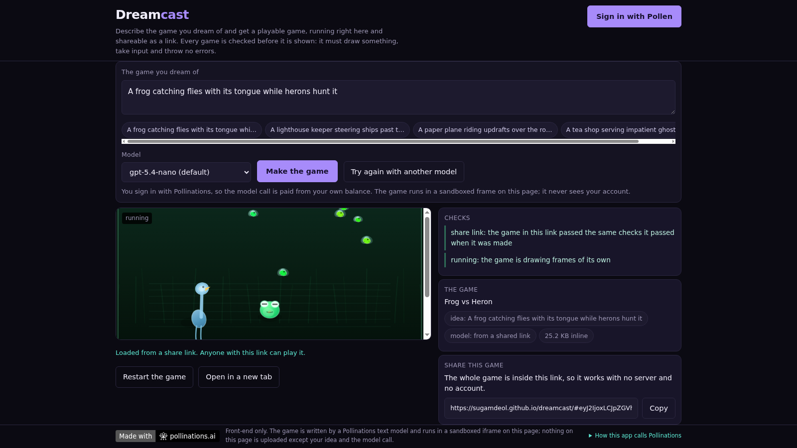

# Dreamcast

Describe the game you dream of and get a playable game you can share.

[](https://pollinations.ai/?ref=badge)

**Live app:** https://sugamdeol.github.io/dreamcast/



You write one sentence about a game you wish existed. A Pollinations model writes
the whole game as a single HTML file. The app checks that file before it shows
it, runs it in a sandboxed frame, and gives you a link that carries the game
itself, so anyone can open it and play.

## What the checks are for

A model will happily return a file that looks like a game and is not one. Of the
first four games this app was tested against, two threw a `ReferenceError` on
the first frame and one never drew anything. So a reply has to pass all of
these before you see it:

- **Shape.** It is a complete HTML document with its own inline script. A reply
  that was cut off is closed rather than left broken.
- **Contents.** No outside scripts, no CDN links, no `@import`, no `fetch`, no
  `XMLHttpRequest`, no `localStorage`, and it cannot reach out of its own frame.
- **Gameplay.** It draws to a canvas, and it has both a loop and some way to
  take input. A canvas alone is not a game, and a loop that draws nothing is
  not either.
- **Runtime.** The game is loaded into a sandboxed frame with a small harness
  that watches for the first painted frame and for script errors. A game that
  throws is reported as a failed check, not handed to you as a black screen.

If the model you picked does not finish, one other model is tried once. There is
no retry loop.

## Models used by default

The model picker offers four text models. `GET https://gen.pollinations.ai/v1/models`
lists every one of them with `paid_only: false`, so each works for a signed-in
free user spending their own Pollen:

```json
{"id": "openai/gpt-5.4-nano",  "category": "text", "paid_only": false, "input_modalities": ["text", "image"], "output_modalities": ["text"], "supported_endpoints": ["/v1/chat/completions", "/text", "/v1/responses", "/v1/messages"]}
{"id": "openai/gpt-5.4-mini",  "category": "text", "paid_only": false, "input_modalities": ["text", "image"], "output_modalities": ["text"], "supported_endpoints": ["/v1/chat/completions", "/text", "/v1/responses", "/v1/messages"]}
{"id": "openai/gpt-5.6-luna",  "category": "text", "paid_only": false, "input_modalities": ["text", "image"], "output_modalities": ["text"], "supported_endpoints": ["/v1/chat/completions", "/text", "/v1/responses", "/v1/messages"]}
{"id": "openai/gpt-5.3-codex", "category": "text", "paid_only": false, "input_modalities": ["text", "image"], "output_modalities": ["text"], "supported_endpoints": ["/v1/chat/completions", "/text", "/v1/responses", "/v1/messages"]}
```

The model id is the `model` field of the `POST /v1/chat/completions` call, and
each id is one of the four entries in the `MODELS` list in `app.js`. The sign-in
request asks for the `text` scope only, so a visitor grants exactly that.

## How this app calls Pollinations

Sign-in is the Pollinations OAuth code flow with PKCE, so there is no key to
paste and the token stays in this tab's `sessionStorage`. Making a game sends
one call:

```
POST https://gen.pollinations.ai/v1/chat/completions
  model=openai/gpt-5.4-nano
  max_tokens=16000, reasoning_effort=low
```

The system prompt asks for one self-contained HTML file with the `<style>` and
`<script>` inline, and the reply is checked in the browser before it is shown.

The game itself is never uploaded anywhere. It runs in an iframe with
`sandbox="allow-scripts allow-pointer-lock"`, so it has no access to this page,
your Pollen account or the network.

## Run it

No build step and no dependencies:

```sh
python3 -m http.server 8000
```

Then open <http://127.0.0.1:8000/>. The microphone is not used here, but a
secure context is still the right way to serve it.

```sh
node --test core.test.js
```

## The share link

The whole game is base64url encoded into the URL fragment, so a share link
carries the game with it and needs no server and no account:

```
https://sugamdeol.github.io/dreamcast/#<base64url of {idea, html}>
```

A link is only produced for a game that passed the checks, and a link is
re-checked when it is opened, so a game that somehow fails the checks is not
loaded from a link either.

## Files

- `core.js` - reply extraction, the static checks, the runtime harness, the
  share token. Pure functions, no DOM and no network.
- `app.js` - sign-in, the model call, the frame, the share link.
- `core.test.js` - 21 tests over extraction, the checks, the harness and the
  share token.
